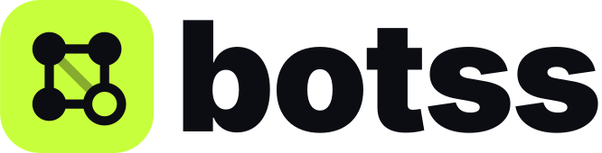
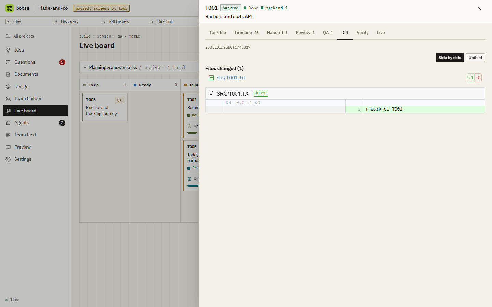

<div align="center">

<picture>
  <source media="(prefers-color-scheme: dark)" srcset="docs/brand/botss-logo-dark.svg">
  
</picture>

# Botss

**An AI software team that runs on your own machine, on your own Claude Code subscription.**

You describe an app. A product manager, tech lead, designer, backend and frontend engineers, QA, a code reviewer, and DevOps plan it with you and build it in parallel, while you watch everything on a live dashboard and approve each step.

[Quickstart](#quickstart) · [How it works](#how-it-works) · [Your first build](#your-first-build) · [Dashboard tour](#dashboard-tour) · [Safety and cost](#safety-and-cost) · [FAQ](#faq)


</div>

---

## What is Botss?

Botss turns Claude Code into a small software company that works for you:

**Just enough process.** Every request is sized first by the tech lead, like a real lead sizing a ticket:

| Track | For | What happens |
|---|---|---|
| **Quick** | UI tweaks, copy changes, small fixes | The tech lead writes 1 to 3 tasks and the engineer does them right away. The task's own checks must pass; no PRD, design, review rounds, or approvals. You get a "done" notification. |
| **Standard** | A feature that needs a short spec | A one-page PRD for you to approve, then a plan to approve, then the build with review and QA. |
| **Full** | A new product or a big feature | The whole flow below. |

Pick **Auto** (the default) to let the tech lead decide, or choose a track yourself. When a request is done, just send the next one. You can cancel the current work at any time; finished work stays.

The full flow:

1. **You write an idea**, in plain words ("a booking app for my barbershop").
2. **The PM asks you a short batch of questions**, each with a recommended answer, then writes a PRD (product requirements document) for you to approve.
3. **The designer proposes 2 to 3 visual directions.** You pick one, and they produce design tokens and screen mockups.
4. **The tech lead writes the architecture and API contracts**, then a task plan that is checked by code: no dependency cycles, and no two parallel tasks editing the same files.
5. **You choose the team size**, and the build starts. Engineers work in parallel, **directly in your project folder**, like a team sharing one office: each task owns its own files, so nobody steps on anyone else. Every task goes through **tests → code review → QA → done**, and the project's checks run after each one.
6. **You approve the release** and merge the finished app into your own branch.

Each team member is a headless **Claude Code** process started by Botss. The roles follow plain-markdown playbooks ("skills") that you can read and edit. Everything they do (files edited, commands run, messages, decisions, reviews) streams to a dashboard at `http://127.0.0.1`.

**What you get at the end:** a working, tested app in your repo. The default stack is Next.js, FastAPI and PostgreSQL, with Docker Compose for local development and GitHub Actions CI. Botss never deploys anything.

### Why Botss

| | |
|---|---|
| 🏠 **Local first** | Runs on your machine, binds to `127.0.0.1`, needs a random access token, and has no telemetry or cloud service. |
| 🔑 **Your subscription** | Uses the official `claude` CLI with your own login. Botss never reads or stores your credentials and never calls Anthropic APIs directly. |
| 🧭 **You stay in charge** | Approval gates for the PRD, design, architecture, plan, and release. A kill switch. Agents ask you when something costs money, needs a key, or changes scope. |
| 🧱 **Real engineering, not vibes** | Contracts before code, test-first tasks, a `verify` command that must pass before a task counts as done, independent code review, QA with bug reports, and project checks after every finished task. |
| 👀 **Watch them work** | Each agent's card shows what it is doing in plain words ("Running the tests", "Messaging the frontend engineer"), its own plan as a live checklist with a progress bar, the files it touched, and where its task is (building, review, QA, done). |
| 🔔 **You hear about what matters** | Pop-up and desktop notifications when something needs your approval, an agent asks you a question, a task is blocked, or a task is done. |
| 💸 **Easy on your usage** | Small changes skip the long process, routine runs (sizing, reviews, QA checks, answers) use a lighter model, agents stop early when stuck, and Botss pauses and resumes around Claude Code usage limits. |
| ✏️ **Editable team** | Every role's behavior is markdown in [`skills/`](skills/). Change how your PM writes PRDs or how your reviewer judges code, right in the dashboard. |

---

## Requirements

| Tool | Why | Check |
|---|---|---|
| **Node.js 22.18+** | Runs Botss | `node --version` |
| **Git** (any recent version) | Needed by Claude Code on Windows (Git Bash); Botss itself does not use git for your project | `git --version` |
| **Claude Code**, logged in | The agents ([install](https://docs.claude.com/en/docs/claude-code)), then run `claude` once to log in | `claude --version` |
| **pnpm** | Installs Botss (ships with Node through corepack) | `corepack pnpm --version` |
| **Docker** with Compose | Each agent gets its own database for the apps Botss builds | `docker compose version` |
| **uv** | Python tooling for the default FastAPI backend ([install](https://docs.astral.sh/uv/)) | `uv --version` |

Botss runs on macOS, Linux, and Windows (it is developed on Windows with Git Bash). On Windows, [Git for Windows](https://git-scm.com/download/win) is required, because Botss and Claude Code use its `bash`.

---

## Quickstart

### Option A: let Claude Code set it up (recommended)

```bash
git clone https://github.com/The-Botss-2/Botss.git botss
cd botss
claude
```

Then say **"set up Botss"**. Claude follows [`CLAUDE.md`](CLAUDE.md): it checks your prerequisites, installs Botss, creates your project folder, and starts the dashboard. It explains each step and asks before installing anything system-wide.

### Option B: set it up yourself

```bash
# 1. Get Botss and install it
git clone https://github.com/The-Botss-2/Botss.git botss
cd botss
corepack pnpm install
corepack pnpm build          # builds the dashboard

# 2. Install the `botss` command so it works from any folder
node packages/cli/bin/botss.js setup
#    Windows: adds %USERPROFILE%\.botss\bin to your user PATH.
#    macOS / Linux: installs ~/.local/bin/botss (it tells you if that folder is not on your PATH).
#    Then open a NEW terminal.

# 3. Check your machine
botss doctor
```

From then on, use Botss from **any folder**:

```bash
cd ~/code/my-app        # a new, empty folder or an existing project
botss up                # starts Botss and opens the dashboard for this folder
```

* In a folder that is already a Botss project, the dashboard opens that project.
* In any other folder, the dashboard opens a **folder picker** at that location. Browse, create a new folder, and choose where the app and all its files should go. Botss sets the folder up for you.
* `botss init` does the setup from the terminal instead, if you prefer.

`botss up` prints a link like `http://127.0.0.1:4800/?token=…` and opens it in your browser. Keep that terminal open: **Ctrl+C stops Botss and every agent.** If Botss is already running, `botss up` in another folder just opens the dashboard there.

> 💡 Agents work **directly in the folder you choose**. Botss adds one hidden `.botss` folder (plans, documents, the team's notes) and nothing else: no git repository, branches, or commits. If your folder already uses git, Botss leaves it to you; agents can only read it. To remove the global command: `botss setup --uninstall`.

---

## Your first build

For a small change, type it on the Idea screen and leave the process on **Auto**: it is built right away. The steps below are the **full** track for a new app. Start small. A good first app takes roughly 8 tasks; [`examples/todo-with-auth.md`](examples/todo-with-auth.md) is one you can paste in.

1. **Keep it small at first.** In **Settings**, keep *max concurrent agents* at 2 or 3 and leave every approval gate on.
2. **Idea.** Describe the app, add screenshots or links if you have them, choose a stakes level, and submit.
3. **Questions.** The PM sends one batch of questions, each with a recommended option and why it matters. Answer them, or click **Accept all recommendations**.
4. **PRD.** Read it in **Documents**. Click **Approve**, or **Request changes** with comments, and the PM revises it.
5. **Design.** Each visual direction comes with a live preview of your main screen, so you choose from something you can see. The designer then produces tokens and a mockup of every screen. **Review the mockups at desktop and mobile sizes and approve the design** (or ask for changes) before any architecture or code is written.
6. **Architecture.** Review the tech lead's architecture and API contract, then approve it.
7. **Plan and team.** In **Team builder**, see every task, the dependency graph, the critical path, and a rough time estimate. Pick how many agents per role (more agents than the plan has parallel lanes just wait), then click **Approve plan & start build**.
8. **Watch the build.** **Agents** shows the team at work: each agent's status in plain words, its own plan as a checklist with a progress bar, the files it touched, and its task's stage. Open **Details** on a card for the full live transcript (reasoning, each edit, each command and its output). On the **Live board**, tasks move from *To do* to *Done*. The **Team feed** shows agents messaging each other, reviews, and blocked actions. Notifications pop up when an agent asks you something, a document needs your approval, a task is blocked, or a task is done (turn on desktop notifications from the bell).
   * **Changed your mind?** Click **Request a change** in the header at any point after the PRD is approved. The PM updates the PRD (you approve), the tech lead updates the plan (you approve), and new tasks join the build. Finished work is kept unless your change says otherwise.
9. **Release.** QA runs the full suite on the finished project and Botss writes a release summary. Approve it. Everything is already in your folder.

---

## How it works

```
 Idea ─▶ PM questions ─▶ PRD ──[you approve]──▶ Designer directions + previews ──[you pick]──▶
         tokens + screen mockups ──[you approve]──▶
      ─▶ Tech lead: architecture + contracts ──[you approve]──▶ task plan ──[you approve + pick team]──▶
         T000 scaffold ─▶ T001 infra ─▶ parallel tasks:
                                        engineer (test first, verify) ─▶ reviewer ─▶ QA ─▶ done + checks
      ─▶ QA journey tests on the whole project ─▶ optional security audit ──[you approve]──▶ done
```

* **Every agent is a real Claude Code session.** Botss starts `claude -p` in your project folder with that role's skills added to its system prompt, a scoped access token, and its own ports and Docker Compose project. Parallel agents never collide: each task owns its files, the scheduler never runs two tasks that own the same file, and a guard hook stops edits outside a task's files.
* **No git machinery.** Agents don't create branches or commits. To show what a task changed (for review and for you), Botss keeps a copy of the task's files when it starts and diffs against it.
* **Agents share state only through the `botss` CLI:** `botss task done`, `botss ask @human`, `botss msg @frontend`, `botss review approve`, and so on ([reference](skills/team-protocol/references/botss-cli.md)). The server checks role permissions on every command.
* **Plain code makes the decisions.** Scheduling, permissions, and plan validation are deterministic code, not an LLM. A task is "done" only when its `verify` command passes, review approves it, and QA passes it. If the project's checks fail afterwards, the tech lead gets a repair task.
* **Everything is visible.** Each agent's actions, messages, decisions, reviews, and raw output are stored and streamed to the dashboard, and survive a page reload.
* **Only what you asked for.** Every role follows a scope rule: build exactly what you said and what you approved. Anything an agent thinks is missing becomes a question or a "Later" note you can see, never a silent extra. Reviewers flag unrequested additions.
* **Token-thrifty teamwork.** Each role's system prompt is identical across runs so Claude Code's prompt cache is reused. Messages are short and capped (details go in files), questions to the same role are answered in one batched run, inboxes are trimmed, and interrupted agents resume their own sessions instead of starting over.

### Existing projects

Run `botss up` (or `botss init`) inside a folder that already has code. On your first request the **tech lead surveys the codebase** first: stack, layout, conventions, and the exact test and build commands, written to a short `codebase.md` everyone reads instead of re-exploring. Then the PM plans **only the change you asked for** (a feature or a fix), there is no scaffold, and your project's own checks run after every finished task. Keep a backup (or commit, if you use git) before a big change: agents edit your files directly.

More detail: [Architecture](docs/architecture.md) · [How Botss uses Claude Code](docs/claude-code-integration.md) · [Security review](docs/security-review.md) · [Design decisions](docs/decisions/)

### The team

| Role | What it does |
|---|---|
| **Product manager** | Turns your idea into clarifying questions and a PRD; answers product questions during the build |
| **Tech lead** | Architecture, API and data contracts, the task plan, the app scaffold, integration fixes |
| **Designer** | Visual directions, design tokens, screen specs and HTML mockups; design review of built screens |
| **Backend engineer** | FastAPI endpoints, models, migrations, and tests |
| **Frontend engineer** | Next.js screens, components, and tests |
| **QA engineer** | Verifies each task in the running app, files bugs, writes end-to-end journey tests |
| **Code reviewer** | Read-only review of every task's diff, with severity-rated comments |
| **DevOps engineer** | Docker Compose, Dockerfiles, environment files, CI |
| **Security engineer** *(optional)* | Threat model and a pre-release audit |

---

## Dashboard tour

| Screen | What you do there |
|---|---|
| **Idea** | Describe the app, add attachments and links |
| **Questions** | Answer batched questions (with recommendations) and anything an agent asks `@human`; see alerts |
| **Documents** | Read the PRD, architecture, contracts (OpenAPI rendered), decisions, and plan; compare versions, comment, approve |
| **Design** | Compare live previews of each direction, browse tokens, review every screen mockup at desktop and mobile sizes, approve the design |
| **Team builder** | Task graph, critical path, estimate; choose agents per role and models; start the build |
| **Live board** | Kanban of every task; open one for its file, timeline, handoff, review, QA report, diff, and verify output |
| **Agents** | Watch agents work in real time: a live transcript per agent (its reasoning, each edit with an inline diff, each command and its output), elapsed time; pause or stop one agent |
| **Team feed** | Everything the team does, as it happens; filter by role or task |
| **Preview** | Run the merged app (Docker) and use it in the dashboard |
| **Settings** | Budgets, concurrency, gates, models per role, permission mode, check commands, and the **skills editor** |

The header always shows the phase, open questions, notifications, **Pause/Resume**, and the red **Kill switch**.

<details>
<summary>More screenshots</summary>

**Team feed** (dark theme)


**Questions with recommendations**


**Team builder with the task graph**


**Task diff**


**Documents**


</details>

---

## Commands

| Command | What it does |
|---|---|
| `botss setup [--uninstall]` | Install (or remove) the global `botss` command so it works from any folder |
| `botss init [folder]` | Make a folder a Botss project (adds the hidden `.botss/` folder only) |
| `botss doctor` | Check prerequisites and print fixes. `--login` also confirms Claude Code is logged in (asks first; sends one tiny prompt) |
| `botss up [--port N] [--no-open]` | Start the server and dashboard on `127.0.0.1` (default port 4800) |
| `botss status` | Phase, task counts, and working agents for the current project |
| `botss pause` / `botss resume` | Stop / restart starting new agent runs |
| `botss stop` | **Kill switch:** stop every agent process immediately |
| `botss logs <agent\|task> [-f]` | Recent events for an agent (`backend-1`) or a task (`T012`) |

Agents use the same binary for their own commands (`whoami`, `task`, `msg`, `ask`, `review`, `qa`, ...). You normally never need those.

---

## Safety and cost

**What agents can and cannot do.** A guard hook runs before every file edit and shell command an agent makes, and blocks it with a clear reason when the agent tries to:

* write outside your project folder, or outside the files its task owns (the code reviewer can't edit code at all);
* change git state (add, commit, reset, checkout, push...) in your project;
* delete files outside the project folder, or wipe another agent's Docker volumes;
* call the internet with `curl`/`wget` (localhost only, unless a task allows it);
* read Claude credentials or touch Botss's own database.

Everything else in the shell is allowed, like in Claude Code, so agents can install packages, run tests, and start the app without being stopped. Destructive or paid actions need your approval. Botss is a policy sandbox, not an operating-system sandbox: agents run as your user. For untrusted ideas, run Botss in a VM or container. See the [security review](docs/security-review.md).

**What it costs.** Every agent run uses your Claude Code subscription (or API billing, if you set that up in Claude Code). You control it with:

* **Just enough process:** small changes go straight to an engineer; only big requests get questions, PRD, design, and architecture.
* **Lighter model for routine runs:** sizing a request, answering teammates, code review, and QA checks use Sonnet unless you choose a model per role in Settings.
* **Concurrency:** a global cap (default 3) and per-role counts from the team builder.
* **Usage limits:** when Claude Code reports a limit, Botss pauses, shows the reset time, and resumes on its own afterwards (this can be turned off).
* **Runaway guards:** turn limits per role, a time limit per run, and tasks that fail 3 times in a row are blocked for you to look at.
* **Optional daily cap:** Settings has an optional daily token cap; it is off by default.

---

## Configuration

Most settings live in the dashboard (**Settings**) and are stored per project:

| Setting | Default | |
|---|---|---|
| Max concurrent agents | 3 | Total agents running at once |
| Daily token cap | off | Optional; Botss stops starting runs at the cap |
| Approval gates | all on | PRD, design direction, screen designs, architecture, plan, release; each can auto-approve |
| Models per role | Claude Code default | For example a stronger model for the tech lead and a faster one for the reviewer |
| Max turns per role, run timeout | 80 turns / 45 min | Runaway guards |
| Permission mode | `dontAsk`, shell allowed | Claude Code's tools are allowed; the Botss guard hook decides what is unsafe. `bypassPermissions` is available with a warning |
| Check commands | from the scaffold or codebase survey | Run on the project after every finished task |
| QA per task, security audit | on / off | |

Role definitions, write paths, and the default stack are in [`roles.yaml`](roles.yaml). Role behavior is in [`skills/`](skills/). To change it for one project, edit it in **Settings → Skills** (with reset to default); the project then gets its own copy in `.botss/skills/`.

### Where Botss keeps things in your project

```
my-app/                    your project: the agents' code goes here, like any developer's
  .botss/                  Botss's one hidden folder
    botss.db               the task board, messages, reviews, and history
    docs/                  PRD, design, architecture, contracts, decisions
    tasks/                 the task plan
    handoffs/, reviews/    the team's notes
    snapshots/             copies of each task's files from when it started (for "what changed")
    runs/                  each agent run's prompt and raw output
```

---

## FAQ

**Is this an official Anthropic product?**
No. Botss is an independent open-source project that runs the official Claude Code CLI. See [Usage and terms](#usage-and-terms).

**Does Botss send my code anywhere?**
Only Claude Code talks to Claude, exactly as when you use `claude` yourself. The Botss server listens on `127.0.0.1`, requires a token, and has no telemetry.

**Can I use a different stack?**
Yes. Tell the PM in your idea or answers (for example "use Django and Vue"). The tech lead records the stack in the architecture, and the skills adapt. The built-in skills have the most detail for the default stack.

**Can I add Botss to an existing app?**
Yes. Run `botss up` in the project folder and open it from the dashboard (or run `botss init` there). The tech lead surveys the code first, and the team changes only what you ask for. Commit your work before you start: agents begin from your last commit. See [Existing projects](#existing-projects).

**Can I change the plan once the build has started?**
Yes. Use **Request a change** in the header. The PM updates the PRD and the tech lead updates the plan, each with your approval; tasks already finished are kept, and new tasks wait until you approve the updated plan.

**An agent is stuck or looping. What do I do?**
Open its card on **Agents** to see the raw output, or the task on the **Live board** for its verify output. You can pause that agent, unblock or hold the task, answer its question, or hit the kill switch. Tasks that fail three times stop on their own and alert you.

**What happens if I close the terminal or my machine restarts?**
Agents stop. Run `botss up` again: nothing is lost, interrupted tasks resume on their own sessions, and the board picks up where it left off.

**Can I change how the agents behave?**
Yes. That is the point of skills. Edit them per project in **Settings → Skills**, or in [`skills/`](skills/) before `botss init` to change the defaults.

**Can I use Codex or another agent CLI?**
Not yet. The runner is behind an interface so other CLIs can be added later.

---

## Troubleshooting

| Problem | Fix |
|---|---|
| `botss doctor` says Claude Code is missing | Install Claude Code, run `claude` once to log in, then `botss doctor --login` |
| The dashboard says "open the link printed by botss up" | The page needs the token. Use the full link from the terminal, or run `botss up` again to print it |
| Port 4800 is in use | `botss up --port 4801` |
| Backend tasks fail with "uv: command not found" | Install [uv](https://docs.astral.sh/uv/) and restart `botss up` |
| Agents can't start databases | Start Docker Desktop (or the Docker daemon) and check `docker compose version` |
| Botss paused itself | Check the header: a Claude Code usage limit (resumes on its own), the optional daily cap in Settings, or the kill switch (`botss resume`) |
| `pnpm: command not found` | Use `corepack pnpm …`, or run `corepack enable` once |

---

## Development

```bash
corepack pnpm install
corepack pnpm vitest run                       # unit + end-to-end tests (uses a fake claude: no quota)
corepack pnpm --filter @botss/dashboard e2e    # dashboard browser tests (Playwright)
corepack pnpm --filter @botss/dashboard dev    # dashboard dev server (proxies to a running `botss up`)
```

| Package | |
|---|---|
| `packages/core` | Pure logic: plan validation, collision checks, scheduler, permissions, guard, stream parsing, database schema |
| `packages/server` | API, WebSocket events, orchestrator, agent runner, snapshots (plus an optional isolated git-worktree mode) |
| `packages/cli` | The `botss` command (owner and agent commands, guard hook) |
| `packages/dashboard` | React + Vite + Tailwind dashboard |
| `packages/fake-claude` | A stand-in for `claude` used by every test |

Node runs the TypeScript directly; only the dashboard is built. Tests never call the real Claude. See [CONTRIBUTING.md](CONTRIBUTING.md).

---

## Usage and terms

Botss runs the official Claude Code CLI on your own machine, using your own Claude account and subscription (or API billing, if you configure that in Claude Code). Every agent run counts toward your Claude usage. Botss gives you budgets, a reserve, concurrency caps, and a kill switch, but **you are responsible for your usage and for complying with Anthropic's current terms of service and usage policies** for Claude and Claude Code.

Botss is an independent open-source project and is **not affiliated with, endorsed by, or sponsored by Anthropic**. "Claude" and "Claude Code" are trademarks of Anthropic and are used here only to describe compatibility.

Botss does not deploy software or use paid third-party services on its own. Anything that costs money or touches real external services requires your explicit approval.

## Credits and license

The role skills were shaped by ideas from several open-source projects; see [CREDITS.md](CREDITS.md).

Released under the [MIT License](LICENSE).
