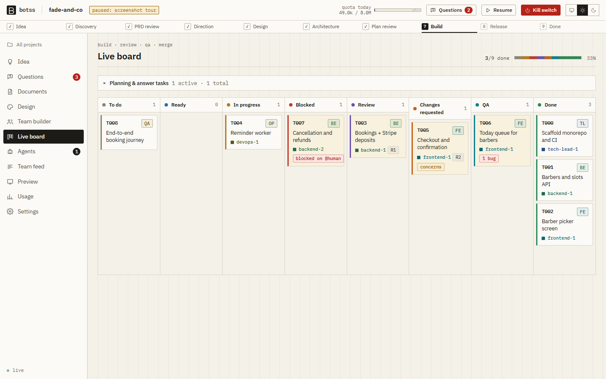
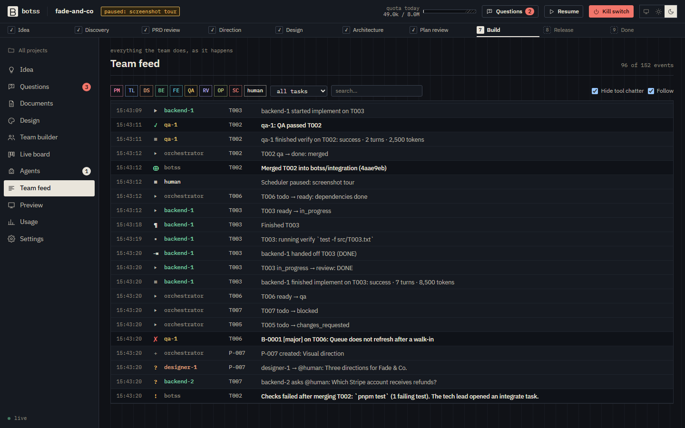
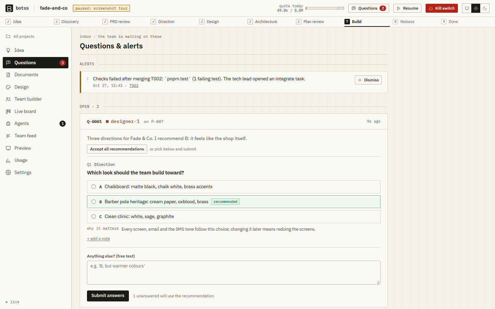
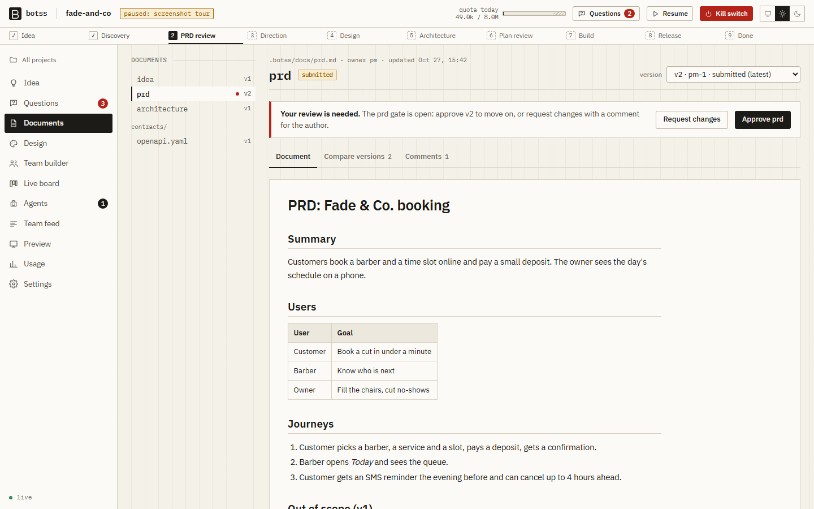
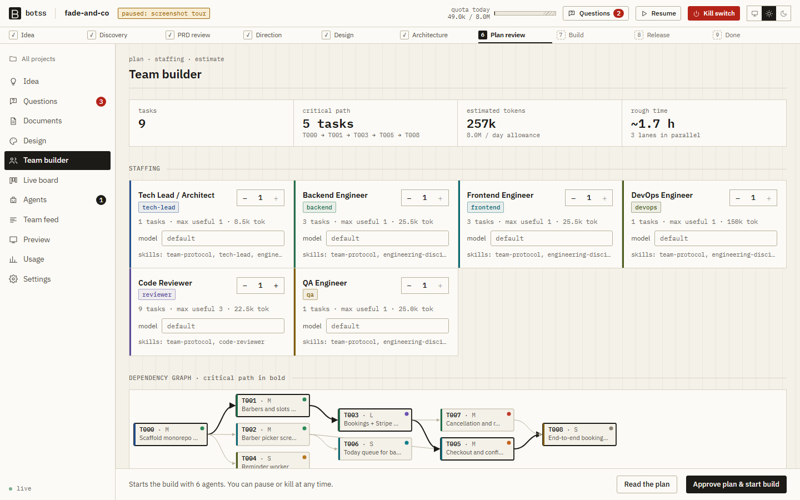

# Botss

**Your own AI software team, running on your machine, on your own Claude Code subscription.**

Describe an app idea. Botss asks you a few sharp questions, writes a PRD, and then a team of agents (product manager, tech lead, designer, backend, frontend, QA, code reviewer, DevOps, and optionally security) designs, plans, and builds it in parallel. Each agent is a headless Claude Code process working in its own git worktree. A live dashboard on `127.0.0.1` shows everything as it happens and lets you approve, answer, steer, pause, and stop.



<details><summary>More screens: team feed, questions, documents, team builder</summary>






</details>

* **Local first.** The server binds to `127.0.0.1`, every request needs a random token, and there is no telemetry and no cloud.
* **Your subscription.** Botss starts the official `claude` CLI with your own login. It never reads, stores, or forwards your credentials, and never calls Anthropic APIs directly.
* **You stay in control.** Approval gates on the PRD, design direction, architecture, plan, and release (all on by default), a kill switch, a daily budget with a reserve for your own use, and a pause when Claude Code reports a usage limit.
* **Real engineering.** Contracts before code, a collision-free task plan, test-first agents, `verify` commands that must pass before a task counts as done, code review, QA, and serialized merges with integration checks.

## Quickstart

The easiest path is to let Claude Code set it up for you:

```bash
git clone https://github.com/The-Botss-2/Botss.git botss
cd botss
claude
# then say: "set up Botss"
```

Claude reads [`CLAUDE.md`](CLAUDE.md), checks your prerequisites, and walks you through each step, asking before it installs anything system-wide.

### Manual setup

Prerequisites: Node.js 22.18+, git 2.20+, [Claude Code](https://docs.claude.com/en/docs/claude-code) (logged in), and for the apps Botss builds: Docker with Compose, `uv`, and pnpm (`corepack enable`).

```bash
git clone https://github.com/The-Botss-2/Botss.git botss && cd botss
corepack enable            # provides pnpm (ships with Node)
pnpm install
pnpm build                 # builds the dashboard
npm link ./packages/cli    # or: alias botss="node --disable-warning=ExperimentalWarning $PWD/packages/cli/src/main.ts"
botss doctor               # check prerequisites
botss init ~/code/my-app   # make a folder a Botss project
cd ~/code/my-app && botss up
```

`botss up` prints and opens `http://127.0.0.1:4800/?token=…`. Type your idea, answer the questions, approve the PRD, pick a design direction, approve the architecture and plan, and watch the team build. When the release is approved, merge the `botss/integration` branch into your main branch yourself; Botss never does that for you.

## How it works

```
Idea → PM questions (one batch) → PRD [you approve]
     → Designer directions [you pick] → tokens + screen specs
     → Tech lead architecture + contracts [you approve]
     → Task plan, validated: no cycles, no file collisions [you approve, choose team size]
     → T000 scaffold → T001 infra → parallel slices
        each task: engineer (test first, verify) → reviewer → QA → merge + integration checks
     → QA journey tests on the merged branch → optional security audit → release [you approve]
```

* **Skills are the playbook.** Each role's behavior is plain markdown in [`skills/`](skills/). `botss init` copies them into your project's `.botss/skills/`, and you can edit them in the dashboard's skills editor.
* **The `botss` CLI is the only shared state.** Agents call `botss task done`, `botss ask @human`, `botss msg @frontend` and so on ([reference](skills/team-protocol/references/botss-cli.md)). The server enforces role permissions, and a guard hook stops writes outside a task's files, force pushes, credential reads, and other unsafe actions.
* **Plain code decides.** Scheduling, permissions, plan validation, and merging are deterministic code, not an LLM.

More detail: [docs/architecture.md](docs/architecture.md) and [docs/claude-code-integration.md](docs/claude-code-integration.md).

### How the orchestrator uses the skills

1. `botss init` copies `skills/` into the target project's `.botss/skills/` on the `botss/integration` branch. That folder is not auto-discovered by Claude Code, so a backend agent is never offered the designer's skills.
2. For each agent run, the orchestrator appends the role's SKILL.md files (in `roles.yaml` order, team-protocol first) to the system prompt with `--append-system-prompt-file`, adds the task file to the prompt, and starts `claude -p` in that agent's worktree. It never touches your credentials; your own `claude` login is used.
3. Reference files are not preloaded. The SKILL.md bodies tell the agent which reference to open and when, which keeps every run's context small and saves quota.

## Commands

| Command | What it does |
|---|---|
| `botss init [path]` | Make a folder a Botss project (git, `.botss/`, skills, `botss/integration` branch) |
| `botss doctor [--login]` | Check prerequisites; `--login` also confirms `claude` is logged in (asks first; uses a tiny bit of quota) |
| `botss up [--port N]` | Start the server and dashboard on 127.0.0.1 |
| `botss status` | Phase, tasks, quota, and working agents |
| `botss pause` / `botss resume` | Stop / restart scheduling new agent runs |
| `botss stop` | Kill switch: stop every agent process now |
| `botss logs <agent\|task> [-f]` | Recent events for `backend-1` or `T012` |

## Usage and terms

Botss runs the official Claude Code CLI on your own machine, using your own Claude account and subscription (or API billing, if you set that up in Claude Code itself). Every agent run counts toward your Claude usage. Botss gives you a daily budget, a reserve percentage for your own use (by default Botss uses at most 80% of the budget you set), concurrency caps, and a kill switch, but **you are responsible for your usage and for following Anthropic's current terms of service and usage policies** for Claude and Claude Code.

Botss is an independent open-source project. It is **not affiliated with, endorsed by, or sponsored by Anthropic**. "Claude" and "Claude Code" are trademarks of Anthropic, used here only to describe compatibility.

Botss never deploys anything or contacts paid external services on its own. Anything that costs money or touches real external services needs your explicit approval in the dashboard.

## FAQ

**Does Botss send my code anywhere?** Only Claude Code itself talks to Claude, exactly as when you use `claude` by hand. The Botss server listens on 127.0.0.1 and has no telemetry.

**How much quota does a build use?** It depends on the app. The plan screen shows an estimate before the build starts (tasks per role × typical run cost), and the Usage screen shows actual usage by day, role, and task. Start with a small idea and a small team.

**What happens when I hit a usage limit?** Botss pauses, shows the reset time, and resumes on its own after the reset (you can turn that off). Interrupted agents continue their own sessions.

**Can I change how the agents work?** Yes. Edit the skills in the dashboard (Settings → Skills) or in `skills/` before `botss init`. Gates, budgets, models per role, turn limits, and the permission mode are in Settings.

**Windows?** Botss is developed and tested on Windows with Git Bash and targets macOS and Linux. On Windows, WSL2 is the recommended setup for the apps Botss builds (Docker, uv).

**What does Botss build by default?** Next.js + TypeScript + Tailwind on the front, FastAPI + SQLAlchemy + Alembic + PostgreSQL on the back, Docker Compose for local dev, and GitHub Actions CI ([`roles.yaml`](roles.yaml)). Tell the PM if you want a different stack.

## Contributing

See [CONTRIBUTING.md](CONTRIBUTING.md). Skill credits: [CREDITS.md](CREDITS.md).

## License

[MIT](LICENSE)
