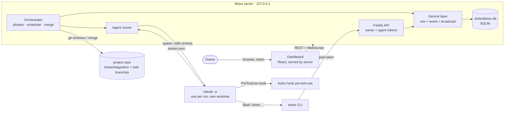

# Botss architecture

Botss is a local-first orchestrator. One Node process (the **server**) owns all state for one or more projects, starts `claude` agent processes, and serves the dashboard. Agents talk to it only through the **`botss` CLI**. Plain code makes every scheduling, permission, merge, and validation decision.



## Packages

| Package | Responsibility |
|---|---|
| `packages/core` | Pure, heavily tested logic: domain types, settings schema, roles.yaml parsing, task-file parsing, plan validation (required fields, unknown `after`, cycles, one role, conservative glob collisions), plan stats (critical path, peak lanes), scheduler decisions, task status transitions, phase machine, permission matrix, guard decisions, stream-json parsing, quota decisions, SQLite schema + migrations |
| `packages/server` | Fastify API, WebSocket event bus, service layer, orchestrator loop, agent runner (`claude` CLI), git/worktree manager, port allocator, prompt assembly, `botss init` logic |
| `packages/cli` | The `botss` binary: owner commands (`init`, `doctor`, `up`, `status`, `pause`, `resume`, `stop`, `logs`) and agent commands (`skills/team-protocol/references/botss-cli.md`), plus `hook pre-tool-use` |
| `packages/dashboard` | React + Vite + Tailwind v4 app, built to static files the server serves |
| `packages/fake-claude` | Test double for `claude`: same flags, realistic stream-json, runs hooks from `--settings`, acts out scenario files |

TypeScript runs directly on Node ≥ 22.18 through type stripping (`erasableSyntaxOnly`), so there is no build step for the server, CLI, or tests; only the dashboard is built. See `docs/decisions/0002-no-build-typescript.md`.

## Where state lives

In the owner's project (`botss init <path>`):

| Path | Committed? | What |
|---|---|---|
| `.botss/botss.db` | no (`.git/info/exclude`) | SQLite board: project, documents + versions, tasks + deps, agents, runs, messages, questions, decisions, handoffs, reviews + comments, QA reports, bugs, events, approvals |
| `.botss/config.yaml`, `.botss/roles.yaml` | no | Initial settings and role definitions (live settings are in the DB) |
| `.botss/runs/<run>/` | no | `system.md`, `prompt.md`, `settings.json` (hook), `guard.json`, `stream.jsonl` |
| `.botss/bin/` | no | `botss` shims put on agents' `PATH` |
| `../.botss-worktrees/<project>/_integration` | worktree of `botss/integration` | Shared truth for agents: `.botss/skills/`, `.botss/docs/` (PRD, architecture, contracts, design, decisions), `.botss/tasks/` |
| `../.botss-worktrees/<project>/<agent>-<task>` | task branch `botss/<id>-<slug>` | One per task, reused across review rounds and resumes, removed after merge |
| `.botss/handoffs/`, `.botss/reviews/`, `.botss/screens/` | no (scratch) | Read by the CLI and stored in the DB |

The owner's own branch is never modified. Botss only commits to `botss/integration` and task branches; the owner decides when to merge `botss/integration`.

## One writer

Every board change goes through `ProjectService` (`packages/server/src/service.ts`): it writes the row, appends an `events` row, and publishes on the bus. The WebSocket endpoint batches events every 100 ms and tells the dashboard which query topics to refetch. The events table is the feed and the replay source, so a page reload rebuilds everything from the API.

## Identity and permissions

* `botss up` generates a random **owner token**. The printed URL carries it; the server sets an `HttpOnly; SameSite=Strict` cookie for static assets, and the dashboard sends `Authorization: Bearer` for API calls. The server binds `127.0.0.1` only and refuses requests whose `Host` is not loopback (DNS-rebinding guard).
* Each agent run gets a **scoped token** (`BOTSS_TOKEN`) tied to project, agent, role, task, and run, revoked when the run ends. `authorize()` in core decides: own-task status changes only, review commands for reviewer/QA/designer, QA commands for QA, `plan submit` for the tech lead, documents by owner role. Violations exit 3.
* The **guard hook** (`botss hook pre-tool-use`) blocks writes outside the worktree or outside `owns + may_touch + role writes + scratch` (symlinks and `..` resolved), the reviewer writing anywhere but `.botss/reviews/`, force pushes, pushes to other branches, merges (except integrate tasks), shared-branch rebases/checkouts, worktree and branch deletion, `rm -r` outside the worktree, other stacks' compose volumes, non-localhost `curl`/`wget`, credential reads, and `botss.db`.

## Phases

```
idea → discovery → prd_review → design_direction → design → architecture_review → plan_review → build → release_review → done
```

Planning work runs as **planning tasks** (`P-001`…, one mode each: `discover`, `draft`, `revise`, `direction`, `system`, `screens`, `architect`, `plan`) in the integration worktree; output is auto-committed. A planning task is done only when its expected output exists (a question batch, a submitted document, a valid plan); otherwise it is retried on the same session, then escalated. Gates (PRD, design direction, architecture, plan, release) are on by default and can be switched to auto-approve per gate.

## Build pipeline (per task)

```
todo → ready (deps done) → implement run → task done (verify must pass) → review run (read only)
     → [changes requested: resume the engineer's session with the comments; cap 3 rounds, then a tech-lead ruling run]
     → QA verify run (own stack) → [fail: bugs back to the engineer, same cap] → merge
```

The scheduler (`schedule()` in core) runs every couple of seconds and on events. It promotes ready tasks, finishes in-flight work first (verify, review, fix, then new work), and starts a run only if the role has a free slot, the global cap allows it, the quota guard allows it, the project is not paused, and no running task owns an overlapping path.

**Merge** is done by the orchestrator only, serialized, in the integration worktree: `git merge --no-ff`, then the project's check commands (captured from the T000/T001 handoffs' `## Checks` section). A conflict or failing check is reverted and becomes an **integrate task** for the tech lead with explicit `owns` (the conflicting files) and the relevant handoffs attached. Questions (`botss ask`) block the task; owner questions appear in the dashboard, teammate questions become **answer tasks** for that role; the answer resumes the asker's session (`--resume`).

## Quota guard

Usage comes from `result` events (input + output + cache-creation tokens count against the budget; cache reads are tracked but not counted). Botss starts runs only while today's usage is under `(100 − reserve)%` of the daily budget (default 80% of 10M tokens) and caps concurrency (default 3). A usage-limit error pauses scheduling until the reset time and resumes automatically. The plan screen shows an estimate: tasks by role × average run cost by role (history first, then defaults), plus review and QA runs.

## Runaway guards and the kill switch

`--max-turns` per role, a wall-clock timeout per run, three failed verifies or three runs that end without finishing → the task is blocked and the owner alerted. The **kill switch** (`botss stop` or the header button) pauses scheduling and kills every agent process tree (`taskkill /T /F` on Windows, process-group `SIGKILL` elsewhere); interrupted tasks keep their session so they resume where they stopped. On restart, any run without an end time is marked interrupted.

## Agent runner interface

`AgentRunner` (`start`, `kill`, `killAll`, `active`) hides the CLI. `ClaudeRunner` is the only implementation; another agent CLI can be added behind the same interface later.
