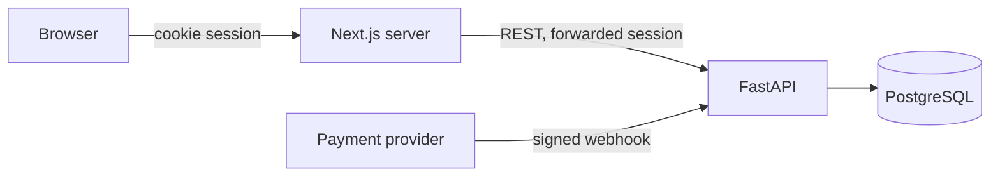

# Threat model: {Product or feature name}

**Scope:** {whole product v1 / feature: file uploads}
**Based on:** PRD v{n}, architecture v{n}
**Date:** {date}

## 1. Assets
| Asset | Why it matters |
|---|---|
| {User accounts and sessions} | {Takeover gives access to orders and personal data} |
| {Customers' personal data: name, phone, address} | {Privacy, legal exposure} |
| {Order and payment status} | {Money; fraud} |

## 2. Actors
| Actor | Access |
|---|---|
| Anonymous visitor | Public pages, sign-up, sign-in |
| Customer | Own orders and profile |
| Admin | All orders, user management |
| {Payment provider webhook} | POST /api/webhooks/payments |

## 3. Trust boundaries and data flows

## 4. Threats
| ID | Boundary / component | STRIDE | Threat | Likelihood | Impact | Rating |
|---|---|---|---|---|---|---|
| TM-1 | GET /api/orders/{id} | I | Customer reads another customer's order by changing the ID | High | High | High |
| TM-2 | POST /api/auth/sign-in | S, D | Credential stuffing; no attempt limit | Medium | High | High |
| TM-3 | Webhook endpoint | S, T | Forged payment confirmation marks unpaid order as paid | Medium | High | High |
| TM-4 | Order create | T | Client-sent price trusted by server | Medium | High | High |

## 5. Security requirements
| From | Requirement | Type | Owner |
|---|---|---|---|
| TM-1 | Given user A, when A requests user B's order by ID, then 404 and no data | Acceptance criterion on T012, T013 | backend |
| TM-1 | AD: repository functions for user-owned data require `user_id` | Architecture rule | tech-lead |
| TM-2 | Sign-in limited to 5 attempts per 15 min per IP and per email; 429 after | New task | backend |
| TM-3 | Webhook verifies provider signature and timestamp; unsigned requests rejected with 400 | Acceptance criterion on T021 | backend |
| TM-4 | Server computes prices from the product table; client price ignored | Acceptance criterion on T015 | backend |

## 6. Accepted risks
| Risk | Why accepted | Accepted by |
|---|---|---|
| {No MFA in v1} | {Prototype stakes; revisit before launch} | {owner, date} |

## 7. Out of scope
{What this model did not cover, e.g. infrastructure hardening of the production host.}
