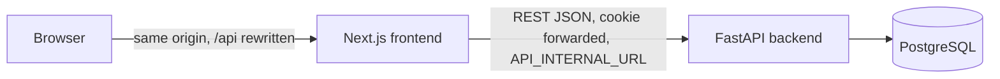
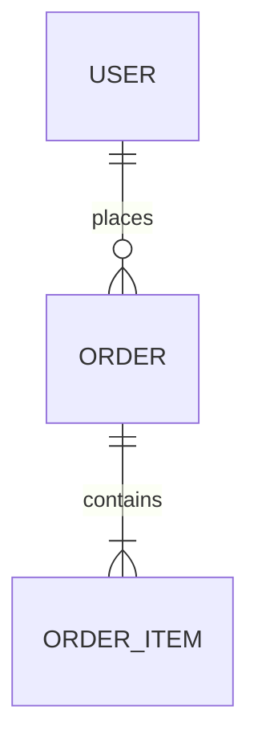

# Architecture: {Product name}

**Status:** Draft v{n}, {date}  |  **PRD:** v{n}  |  **Stakes:** {Prototype / Internal / Launch}

## 1. Overview
Two or three sentences on the shape of the system, plus a container diagram.



## 2. Stack
| Layer | Choice | Version | Why (only if not the team default) |
|---|---|---|---|
| Frontend | Next.js App Router, TypeScript, Tailwind | {16.x} (read the upgrade guide for this major) | |
| Backend | FastAPI, Pydantic v2, SQLAlchemy 2 (async), Alembic | {x.y} | |
| Database | PostgreSQL | {16} | |
| Tests | pytest + httpx, Vitest + Testing Library, Playwright | | |
| Tooling | uv, pnpm, Docker Compose, Ruff, ESLint, Prettier | | |

## 3. Source layout
```
backend/
  app/
    api/            # routers, one module per resource
    core/           # settings, security, db session, errors
    models/         # SQLAlchemy models
    schemas/        # Pydantic schemas
    services/       # business logic
  alembic/
  tests/
frontend/
  src/app/          # routes (App Router)
  src/components/   # shared UI components
  src/lib/api/      # typed API client
  src/lib/          # utilities
e2e/                # Playwright journeys
docker-compose.yml
```
**Dependency direction:** api -> services -> models. Services never import from api. Frontend components never call `fetch` directly; they use `src/lib/api`.

## 4. Architecture decisions (invariants)
**AD-1: {Rule title}**
Binds: {FR IDs, screens, tables}
Prevents: {the divergence it stops}
Rule: {enforceable statement}

## 5. Conventions
(Adapted from the team defaults. Only list what differs or matters most; link the rest.)
| Area | Convention |
|---|---|
| Errors | `{"error": {"code", "message", "details", "request_id"}}` |
| Pagination | cursor, `{items, next_cursor}` |
| IDs | UUID strings |
| Time | UTC ISO 8601 |
| Auth | server-side sessions, `botss_session` cookie (httpOnly, SameSite=Lax, Secure in production), hashed token in `sessions` table |
| Browser to API | same origin via `next.config` rewrite of `/api/:path*`; no CORS |
| Money | `{amount: int minor units, currency}` |

## 6. Data model
See `contracts/data-model.md`.


## 7. API
See `contracts/openapi.yaml`. Summary:
| Method | Path | Auth | FR |
|---|---|---|---|
| GET | /api/orders | user | FR-4 |

## 8. Requirements map
| FR | Screens | Endpoints | Tables | Governing ADs |
|---|---|---|---|---|
| FR-4 | Order list | GET /api/orders | orders | AD-1, AD-3 |

## 9. Operational envelope
* **Local:** `docker compose up` (db, backend on :8000, frontend on :3000)
* **Env vars:** see `.env.example`; required: {list}
* **Migrations:** `alembic upgrade head`, run once by the one-off `migrate` Compose service (not on backend startup)
* **Environments:** `ENVIRONMENT` = `local | test | ci | production`
* **Parallel agents:** the orchestrator exports `COMPOSE_PROJECT_NAME=botss-<agent>` and per-agent ports and database URLs
* **CI:** {lint, type check, tests, build on every push}
* **Deploy target:** {none for MVP / Docker host / Vercel + Fly}
* **Secrets:** environment only; never committed

## 10. Budgets
(Numeric translations of PRD non-functional needs. Omit for prototypes if none.)
* {Order list API p95 under 200 ms with 10k orders: indexed query, one round trip}

## 11. Deferred
Decisions intentionally left to implementers because they cannot cause divergence:
* {Internal helper structure inside services}

## 12. Risks and open questions
| Risk or question | Impact | Owner |
|---|---|---|
